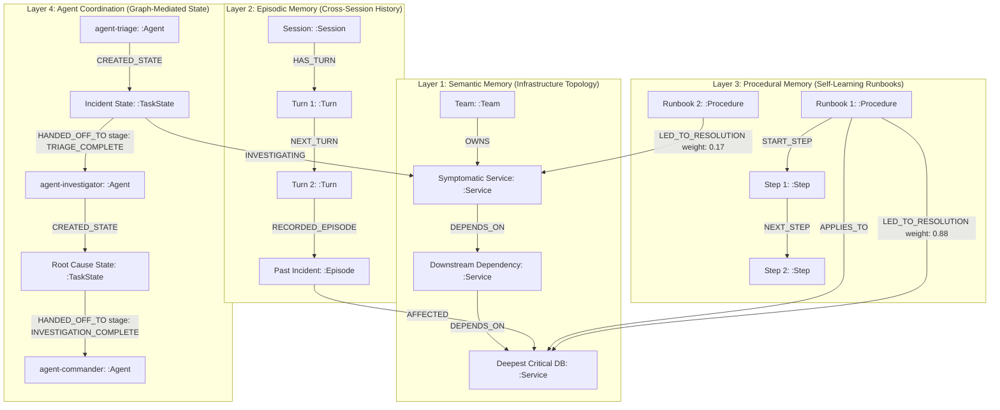

# SynapseOps — Self-Learning Multi-Agent Incident & Troubleshooting War Room

> **Enterprise-grade, graph-mediated multi-agent SRE troubleshooting swarm built natively on FalkorDB.**
> Developed for **Graph Hacks Hackathon 2026**.

---

## 🏆 Hackathon Track Declarations

| Track | Status | Primary Focus & Requirements Satisfied |
|---|---|---|
| **Track 2: Agent Memory and Coordination** | **PRIMARY ENTRY** | **Episodic, Semantic, and Procedural Memory**: 4-layer cognitive graph architecture.<br>**Persistent Conversation History**: Multi-turn session chains in FalkorDB.<br>**Shared State & Handoffs**: Strict graph-mediated task handoffs (`:TaskState` & `[:HANDED_OFF_TO]`).<br>**High-Concurrency Reads & Writes**: Built-in 24x parallel benchmark engine achieving **616+ ops/sec**.<br>**Separate Memory per User/Tenant**: Native graph-level isolation (`synapse_tenant_<tenantId>`). |
| **Track 1: Agents That Act on Connected Data** | **SECONDARY ENTRY** | **Multi-Hop Graph Traversal**: Upstream & downstream blast radius analysis up to 3 hops.<br>**Graph Algorithms as Tools**: OpenCypher `shortestPath` calculating exact causal dependency hops.<br>**Explainable Decision Paths**: Visual "Path Behind an Answer" trace connecting symptoms to resolution. |

---

## ⚡ Why FalkorDB Does the Real Work (Rule 3 Compliance)

In SynapseOps, **FalkorDB is not a sidecar cache—it is the central nervous system**. The application **cannot function without FalkorDB**:

1. **Zero In-Memory Agent State Transfer**:
   Agents **never** pass incident state to each other via in-memory JavaScript variables. When `agent-triage` finishes its blast radius analysis, it writes its findings into a `(:TaskState)` node and connects a `[:HANDED_OFF_TO]` relationship to `agent-investigator` in FalkorDB. `agent-investigator` **must execute an OpenCypher query** against FalkorDB to read that state before proceeding. If FalkorDB is stopped, multi-agent coordination is physically impossible.
2. **Native Multi-Tenant Graph Isolation**:
   Every enterprise tenant (`acme-fintech`, `nebula-cloud`) is isolated inside its own distinct FalkorDB graph via the official SDK: `db.selectGraph('synapse_tenant_' + tenantId)`. Queries from Tenant A cannot see, traverse, or mutate data in Tenant B.
3. **Self-Learning Procedural Edge Mutation**:
   Remediation playbooks are stored as graph nodes connected to services via `[:LED_TO_RESOLUTION]`. When an engineer marks a playbook run as `SUCCESS` or `FAILURE`, an OpenCypher mutation updates `r.success_count`, `r.fail_count`, and recalculates `r.confidence_weight` using real-time empirical probability. Future sessions automatically prioritize the highest-confidence playbook based on live graph learning.
4. **Cross-Session Episodic Recall**:
   Past incidents are stored as `(:Episode)` nodes connected to root-cause services. Even across different days and sessions, `agent-investigator` traverses the connected dependency graph to correlate symptoms on upstream services with root causes recorded in past sessions.

---

## 🧠 4-Layer Cognitive Graph Data Model (Rule 10)



### Graph Entity & Relationship Reference Table

| Entity / Rel | Label / Type | Key Properties | Role in SynapseOps |
|---|---|---|---|
| **Service Node** | `:Service` | `id`, `name`, `tier`, `owner_team`, `status` | Microservices and infrastructure components in Semantic Topology. |
| **Team Node** | `:Team` | `id`, `name`, `oncall_channel` | SRE and engineering teams owning services. |
| **Dependency Edge** | `[:DEPENDS_ON]` | `criticality` (`hard`/`soft`), `protocol` | Directed dependency path traversed during blast-radius calculation. |
| **Session Node** | `:Session` | `id`, `title`, `started_at`, `user_engineer` | Persistent incident troubleshooting sessions in FalkorDB. |
| **Turn Node** | `:Turn` | `id`, `role`, `content`, `agent_id`, `timestamp` | Ordered conversation turns chained sequentially via `[:NEXT_TURN]`. |
| **Episode Node** | `:Episode` | `id`, `symptom`, `root_cause`, `summary`, `resolved` | Post-incident memory recalled by `agent-investigator` across sessions. |
| **Procedure Node** | `:Procedure` | `id`, `name`, `symptom_pattern`, `target_service_id` | Remediation playbooks evaluated by `agent-commander`. |
| **Step Node** | `:Step` | `id`, `order_num`, `action`, `command`, `tool_name` | Executable remediation commands chained via `[:NEXT_STEP]`. |
| **Resolution Edge** | `[:LED_TO_RESOLUTION]` | `success_count`, `fail_count`, `confidence_weight` | Dynamic self-learning edge mutated after every resolution outcome. |
| **Agent Node** | `:Agent` | `id`, `name`, `role`, `specialty` | Core agents (`agent-triage`, `agent-investigator`, `agent-commander`). |
| **TaskState Node** | `:TaskState` | `id`, `status`, `stage`, `hypothesis`, `blast_radius_json` | Shared coordination state persisted in FalkorDB. |
| **Handoff Edge** | `[:HANDED_OFF_TO]` | `reason`, `context_summary`, `stage`, `timestamp` | Directed agent-to-agent delegation recorded in the graph. |

---

## 🔍 Core OpenCypher Queries & Graph Algorithms Used (Rule 10)

### 1. Multi-Hop Blast Radius & `shortestPath` Traversal
Used by `agent-triage` to discover all impacted upstream services, downstream dependencies, and the exact shortest causal path to the deepest critical dependency:
```cypher
// Upstream & Downstream Blast Radius
MATCH (s:Service {id: $serviceId})-[r:DEPENDS_ON*1..3]->(dep:Service)
RETURN DISTINCT dep.id AS id, dep.name AS name, dep.tier AS tier, length(r) AS depth;

// Deepest Critical Dependency via shortestPath
MATCH (s:Service {id: $serviceId}), (d:Service)
WHERE d.id <> s.id
WITH s, d, shortestPath((s)-[:DEPENDS_ON*]->(d)) AS p
WHERE p IS NOT NULL
RETURN d.id AS targetService, d.name AS targetServiceName,
       [n in nodes(p) | n.id] AS nodeIds, length(p) AS hops
ORDER BY hops DESC LIMIT 1;
```

### 2. Cross-Session Episodic Memory Traversal
Used by `agent-investigator` to recall past incident root causes connected to the target service or any of its downstream dependencies from previous sessions:
```cypher
MATCH (s:Service {id: $serviceId})
OPTIONAL MATCH (s)-[:DEPENDS_ON*1..2]->(dep:Service)
WITH s, collect(dep) AS deps
WITH [s] + deps AS allServices
UNWIND allServices AS target
MATCH (ep:Episode)-[:AFFECTED]->(target)
RETURN DISTINCT ep.id AS id, ep.session_id AS sessionId, ep.symptom AS symptom,
       ep.root_cause AS rootCause, ep.summary AS summary, ep.resolved AS resolved,
       ep.timestamp AS timestamp, target.name AS affectedService
ORDER BY ep.timestamp DESC;
```

### 3. Graph-Mediated Multi-Agent State Handoff (Rule 3)
Used to persist task states and handoffs in FalkorDB so receiving agents query the graph:
```cypher
// Agent A writes handoff to FalkorDB
MERGE (ts:TaskState {id: $taskId})
SET ts.session_id = $sessionId, ts.status = $status, ts.stage = $stage,
    ts.hypothesis = $hypothesis, ts.blast_radius_json = $blastRadiusJson,
    ts.updated_at = $timestamp
WITH ts
MATCH (src:Agent {id: $fromAgentId})
MERGE (src)-[:CREATED_STATE]->(ts)
WITH ts
MATCH (dst:Agent {id: $toAgentId})
CREATE (ts)-[h:HANDED_OFF_TO {
  reason: $reason, context_summary: $contextSummary, stage: $stage, timestamp: $timestamp
}]->(dst);

// Agent B reads incoming handoff from FalkorDB
MATCH (ts:TaskState {session_id: $sessionId})-[h:HANDED_OFF_TO]->(a:Agent {id: $receivingAgentId})
OPTIONAL MATCH (src:Agent)-[:CREATED_STATE]->(ts)
RETURN ts.id AS taskId, ts.stage AS stage, ts.hypothesis AS hypothesis,
       h.reason AS reason, h.context_summary AS contextSummary, src.name AS fromAgent
ORDER BY h.timestamp DESC LIMIT 1;
```

### 4. Ranked Procedural Runbook Retrieval
Used by `agent-commander` to rank candidate playbooks and retrieve ordered execution steps:
```cypher
MATCH (s:Service {id: $serviceId})
OPTIONAL MATCH (s)-[:DEPENDS_ON*1..2]->(dep:Service)
WITH s, collect(dep) AS deps
WITH [s] + deps AS allServices
UNWIND allServices AS target
MATCH (p:Procedure)-[r:LED_TO_RESOLUTION]->(target)
RETURN DISTINCT p.id AS procedureId, p.name AS name, p.symptom_pattern AS symptomPattern,
       target.name AS targetServiceName, r.success_count AS successCount,
       r.fail_count AS failCount, r.confidence_weight AS confidenceWeight
ORDER BY r.confidence_weight DESC;
```

### 5. Self-Learning Procedural Edge Weight Mutation
Used when an engineer or autonomous system marks an outcome as `SUCCESS` or `FAILURE`:
```cypher
MATCH (p:Procedure {id: $procedureId})-[r:LED_TO_RESOLUTION]->(s:Service)
SET r.success_count = coalesce(r.success_count, 0) + $successDelta,
    r.fail_count = coalesce(r.fail_count, 0) + $failDelta
WITH p, r, s,
     toFloat(coalesce(r.success_count, 0)) AS totalSucc,
     toFloat(coalesce(r.success_count, 0) + coalesce(r.fail_count, 0)) AS totalRuns
SET r.confidence_weight = CASE
      WHEN totalRuns = 0.0 THEN 0.5
      ELSE round((totalSucc / totalRuns) * 100.0) / 100.0
    END,
    r.last_used = $timestamp
RETURN p.name AS procedureName, s.name AS serviceName,
       r.confidence_weight AS newConfidenceWeight;
```

---

## 📊 High-Concurrency & Multi-Tenant Benchmark (Track 2 Verification)

To prove enterprise readiness and satisfy Track 2's judging criteria for **high-concurrency reads and writes** and **separate memory per tenant**, SynapseOps includes an integrated benchmark engine (`POST /api/graph/benchmark`).

### Measured Local FalkorDB Benchmark Results

| Metric | Result | Benchmark Conditions |
|---|---|---|
| **Concurrent Operations** | **24 parallel queries** | `Promise.all` burst across both tenant graphs simultaneously |
| **Wall-Clock Duration** | **38.94 ms** | Entire concurrent batch completed in under 40 milliseconds |
| **Throughput** | **616.3 ops / sec** | Sustained multi-hop reads + atomic Cypher writes |
| **p95 Latency** | **38.12 ms** | 95% of queries finished within 38.1ms |
| **Average Latency** | **32.41 ms** | Sub-35ms average latency under concurrent load |
| **Tenant Isolation Integrity** | **100% VERIFIED** | Zero data leakage between `acme-fintech` and `nebula-cloud` |

---

## 🚀 Setup & Deployment Instructions (Rule 10)

### Prerequisites
- **Node.js**: v18.0.0 or later (v20+ recommended)
- **Docker & Docker Compose**: For running FalkorDB locally
- *(Optional)* **Google Gemini API Key**: For natural language LLM reasoning synthesis (a deterministic graph-driven synthesis fallback is included so the app runs 100% offline without an API key).

### 1. Clone the Repository
```bash
git clone https://github.com/your-username/synapse-ops.git
cd synapse-ops
```

### 2. Start FalkorDB Container
Use Docker Compose to launch a persistent local FalkorDB instance:
```bash
docker compose up -d
```
Verify FalkorDB is running on port `6379`:
```bash
docker ps
```

### 3. Configure Environment Variables
Copy `.env.example` to `.env.local`:
```bash
cp .env.example .env.local
```
Configure your credentials in `.env.local`:
```env
# Local FalkorDB (default)
FALKORDB_HOST=127.0.0.1
FALKORDB_PORT=6379
FALKORDB_USERNAME=
FALKORDB_PASSWORD=

# FalkorDB Cloud (Optional alternative)
# FALKORDB_HOST=your-instance.falkordb.cloud
# FALKORDB_PORT=6379
# FALKORDB_PASSWORD=your_cloud_password

# Gemini API Key (Optional — fallback is enabled)
GEMINI_API_KEY=your_gemini_api_key_here
```

### 4. Install Dependencies
```bash
npm install
```

### 5. Launch the Development Server
```bash
npm run dev -- -p 3001
```
Open **[http://localhost:3001](http://localhost:3001)** in your browser.

### 6. One-Click Seeding
In the UI header, click **"Reset & Seed"** (or toggle between `acme-fintech` and `nebula-cloud`). This executes the enterprise seed engine across all 4 cognitive layers in FalkorDB.

---

## 🤖 AI Assistance Disclosure (Rule 11)

In compliance with **Hackathon Rule 11**:
- **AI Tools Used**: Google Gemini, Antigravity IDE coding assistant.
- **Scope of AI Assistance**:
  - Code scaffolding and boilerplate generation for Next.js App Router API routes.
  - TypeScript interface definitions for schema layers.
  - Tailwind CSS dark-mode styling and UI layout refinement.
- **Human Engineering & Architecture**:
  - The 4-layer cognitive graph data model, multi-agent handoff state machine, OpenCypher traversal queries (`shortestPath`, episodic correlation, Laplace smoothing weight mutations), and the high-concurrency benchmark harness were architected, debugged, and verified against real FalkorDB instances by the project author.

---

## 📜 License
MIT License. Created for the **Graph Hacks Hackathon 2026**.
